### Designing clarity into systems that cannot stay simple.

I lead product design for complex software: AI workflows, healthcare platforms, and enterprise tools. I work
close enough to engineering to protect the idea through production, and I write the front-end myself when
that is what keeps it intact.

**[Portfolio and case studies →](https://juancoloradov.github.io/portfolio/)** &nbsp;·&nbsp;
**[LinkedIn](https://linkedin.com/in/juan-david-colorado-vargas-470b20122)** &nbsp;·&nbsp;
**[CV (PDF)](https://juancoloradov.github.io/portfolio/assets/Juan_David_Colorado_CV.pdf)**

## Now building

**[pd-design-team](https://github.com/JuanColoradoV/pd-design-team)** is a product-design team for AI agents:
16 open-source skills, from research to developer handoff, that bind to your real design system, design
every state, and say what they couldn't check. It works with Figma, Penpot, Pencil, Sketch, Framer, or code.

## How I work

- **Evidence over theatre.** Every case is a decision trail: what was unclear, what changed, what shipped,
  and what the evidence can and cannot prove.
- **Systems, not screens.** Tokens, components, and an accessibility floor (WCAG 2.2 AA) that survive the
  handoff instead of being redrawn by engineering.
- **Close to the code.** HTML, CSS, JavaScript, TypeScript, and Flutter. Prototypes that behave like the
  product, and builds that match the design.

Medellín, Colombia · English and Spanish
